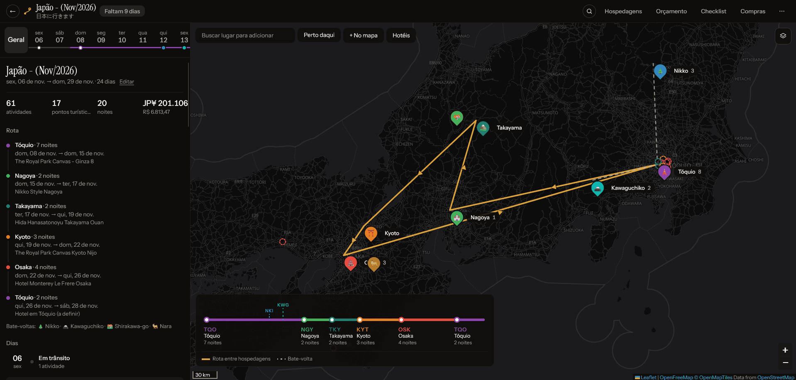
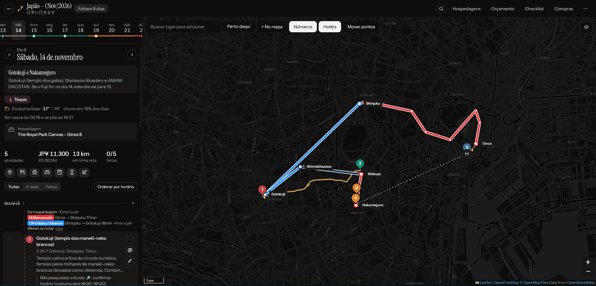
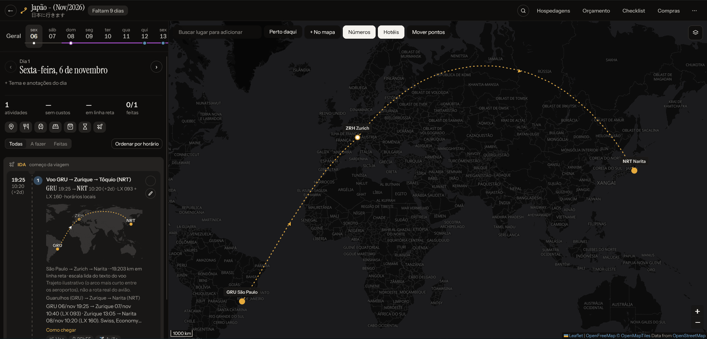

# 🧳 Trip Planner

Um planner de viagens pessoal: mapa, roteiro dia a dia com horários, hospedagens, orçamento na moeda da viagem e checklist,
tudo num app web que você hospeda de graça e abre no celular como se fosse um app.

> **Projeto pessoal e "vibecoded".** Fiz este app para planejar uma viagem minha, conversando em português com o
> [Claude](https://claude.ai) (pelo Claude Code): eu descrevia o que queria, o Claude escrevia o código, e eu testava e pedia
> ajustes. Quase nenhuma linha foi digitada à mão. Ele funciona bem para mim, mas não é um produto: não tem testes
> automatizados, suporte nem garantia de que vai continuar evoluindo. Use, copie e adapte à vontade.
>
> Este repositório tem **só o código**. Os dados de qualquer viagem ficam no banco de cada instalação, nunca no git, e o
> exemplo que vem junto é inventado.

<p align="center">
  
</p>

<p align="center">
  
  
</p>

<sub>Capturas do app com a viagem real do autor (Japão, novembro de 2026). O mapa-base (ruas) pode aparecer escurecido ou sem detalhes conforme a captura.</sub>

## Quero o meu

O caminho completo, do zero até o link no celular, está em **[docs/GUIA.md](docs/GUIA.md)**. Em resumo:

1. Faça um fork (ou cópia) deste repositório.
2. Crie um banco grátis no [Turso](https://turso.tech) e guarde a URL e o token.
3. Importe o repositório na [Vercel](https://vercel.com), crie as variáveis `TURSO_DATABASE_URL`, `TURSO_AUTH_TOKEN` e `APP_PASSWORD` e faça o deploy.
4. Abra o link, entre com a sua senha e crie a sua viagem (ou importe o exemplo para conhecer o app).

Para só experimentar no computador:

```bash
npm ci
npm run dev      # abre em http://localhost:5173
```

Requer **Node 22.13+**. Localmente os dados ficam em `data/planner.db`, que está no `.gitignore`.

## O que tem

- **Várias viagens** na mesma instalação, com contagem regressiva, duplicar, exportar e importar backup (JSON).
- **Mapa** com cidades, hospedagens, rota entre elas e bate-voltas; a rota também aparece como um diagrama de linha de metrô.
- **Roteiro dia a dia** em blocos (manhã, café, almoço, jantar e o que vem depois de cada um), com horário, duração, custo e deslocamento.
- **Caminho no mapa**: trechos a pé pelas ruas e linhas de trem/metrô na cor da linha, com embarque, baldeações e desembarque.
- **Opções no mesmo horário** num carrossel (três cafés da manhã possíveis, por exemplo), só a principal conta no orçamento.
- **Voos e trens com fuso** em cada ponta; ida e volta ganham um cartão próprio no dia.
- **Hospedagens** com check-in/out, número da reserva, preço e link, no cabeçalho de cada dia.
- **Orçamento** na moeda da viagem convertido para a sua, por dia, cidade e tipo; **estatísticas** de gasto e distância.
- **Compras** com a cota de isenção da Receita (US$ 1.000 por padrão, editável) e estimativa do imposto.
- **Checklist**, **ideias sem data**, **calendário**, **busca**, notas, links e **anexos** (ingressos, vouchers) em cada atividade.
- **Modo hoje**: durante a viagem abre no dia atual, destaca a próxima atividade e oferece "Como chegar".
- **Extras**: tempo previsto, câmbio automático, nascer e pôr do sol, Wikipédia, "Meu mapa" de países visitados, lembretes.
- **Exportar**: PDF, arquivo `.ics` para a agenda e link só de leitura para compartilhar o roteiro.
- **Celular e offline**: instalável como app (PWA), tema claro/escuro e aparência ajustável.

A seção "Novidades" da tela inicial (arquivo `web/src/changelog.js`) conta a história de cada versão.

## Documentação

- **[Funcionalidades](docs/funcionalidades/README.md)**: tudo o que o app faz e como usar cada coisa, passo a passo, com dicas,
  limitações e como funcionam por baixo as partes menos óbvias (como o reconhecimento das escalas do voo). Cada versão
  nova no changelog atualiza a página da área que mudou.
- **[Guia de hospedagem](docs/GUIA.md)**: do fork ao link no celular, com Turso e Vercel.
- **[Detalhes técnicos](docs/TECNICO.md)**: variáveis de ambiente, scripts e API.

## Stack

| Parte | O que usa |
| --- | --- |
| Front-end | React 18, Vite 5, Leaflet + MapLibre (mapa vetorial OpenFreeMap) |
| API | Express 4, rodando como uma única função serverless na Vercel (`api/index.js`) |
| Banco | SQLite via `@libsql/client`: arquivo local no computador, [Turso](https://turso.tech) quando publicado |
| Hospedagem | Vercel (plano grátis) + Turso (plano grátis) |
| Serviços públicos | OpenFreeMap/OpenStreetMap (mapa e busca), OSRM (rotas a pé), Open-Meteo (tempo), Frankfurter (câmbio), Wikipédia |

Nenhum serviço pede chave de API. A única senha é a `APP_PASSWORD`, que você escolhe.

## Estrutura

```
api/index.js           entrada da Vercel: carrega a API inteira como uma função
server/app.js          rotas /api/*, esquema e migrações do banco
server/db.js           conexão: arquivo SQLite local ou Turso
server/examples/       viagem de exemplo fictícia (carregável pela API)
examples/              a mesma viagem de exemplo como backup JSON, para importar na tela inicial
web/src/               front-end React (Home, TripView, DayPanel, MapView, Modals…)
docs/                  guia de instalação, funcionalidades, detalhes técnicos e capturas
.claude/skills/        skills de design usadas pelo Claude durante o desenvolvimento
```

Detalhes da API estão em [docs/TECNICO.md](docs/TECNICO.md); o formato do backup (incluindo os campos `alt` e `route`), em
[Compartilhar e backup](docs/funcionalidades/compartilhar-e-backup.md#formato-do-json).

## Como foi feito

Tudo foi construído em conversas com o Claude, versão por versão (são mais de 25, listadas em "Novidades"). Algumas coisas
que ajudaram e que você pode reaproveitar se quiser continuar o projeto do mesmo jeito:

- **Skills de design em `.claude/skills/`**: o Claude Code lê essas instruções antes de mexer na interface. O visual (preto
  chapado, tipografia Instrument Sans/Serif, uma cor de destaque) segue a `design-taste-frontend`. Para checar a interface:
  `node .claude/skills/design-taste-frontend/scripts/lint.mjs --app web/src`.
- **Pedidos pequenos e concretos** ("o mapa fica preso num canto quando o voo sai do Brasil") funcionaram melhor que pedidos grandes.
- **Uma entrada no changelog a cada entrega**, escrita para quem usa o app, deixou fácil acompanhar o que mudou.

## Créditos

- [AdventureLog](https://github.com/seanmorley15/AdventureLog) (GPL-3.0): inspiração para várias funções (hospedagens completas,
  ideias sem data, checklist, compartilhamento). Nenhum código dele foi copiado, só ideias.
- Skills [`design-taste-frontend`](https://github.com/leonxlnx/taste-skill) (MIT, Leonxlnx) e
  [`impeccable`](https://github.com/pbakaus/impeccable) (Apache-2.0, Paul Bakaus), incluídas em `.claude/skills/` com as licenças originais.
- Dados de mapa © colaboradores do [OpenStreetMap](https://www.openstreetmap.org/copyright), estilos do [OpenFreeMap](https://openfreemap.org),
  fronteiras e estados do [Natural Earth](https://www.naturalearthdata.com) (domínio público).
- Feito com [Claude](https://claude.ai) e [Claude Code](https://claude.com/claude-code).

## Licença

[MIT](LICENSE). Pode usar, modificar e hospedar a sua versão; só mantenha o aviso de copyright.
