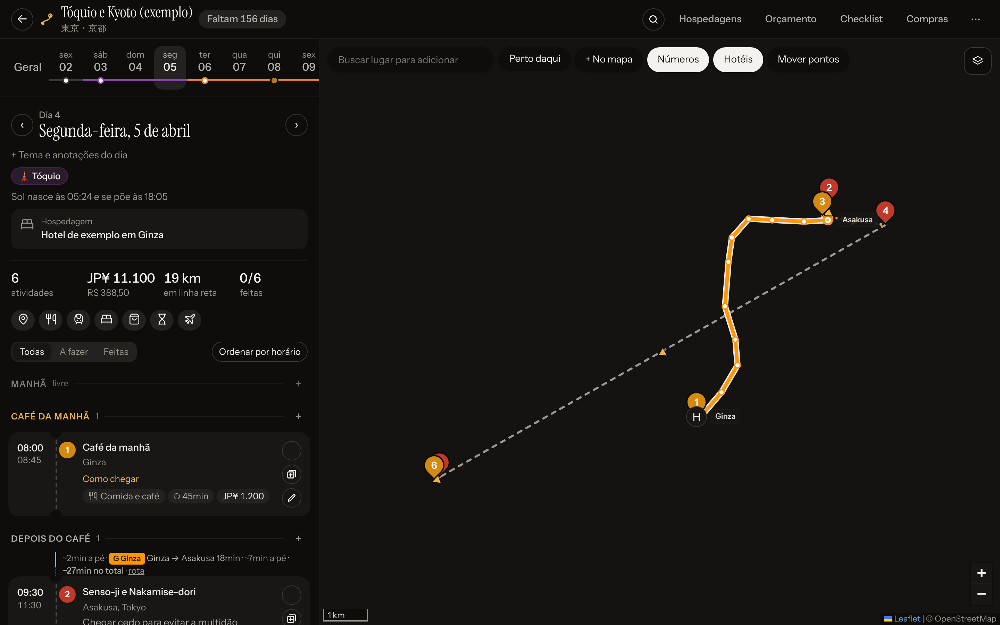
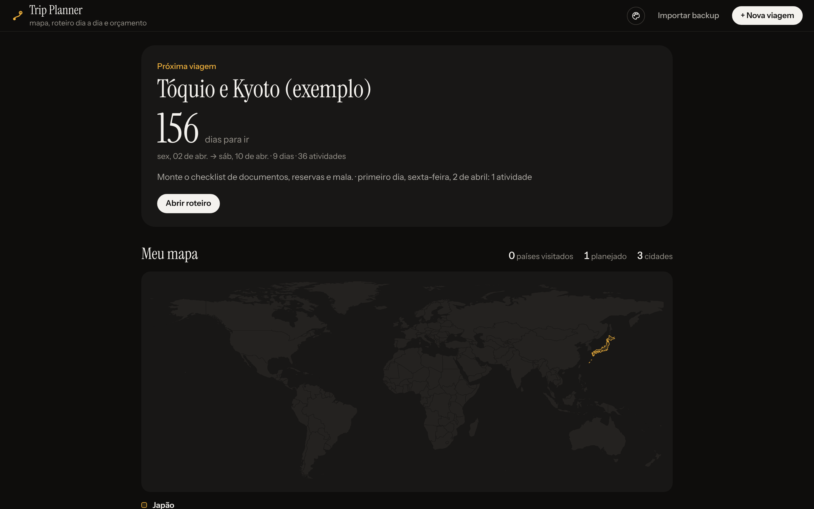
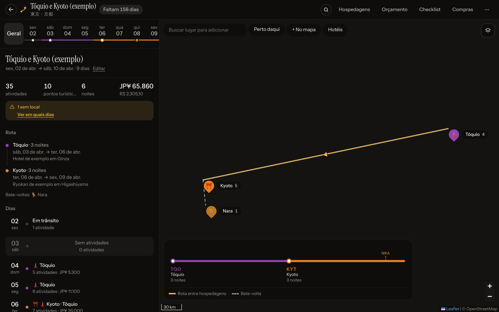
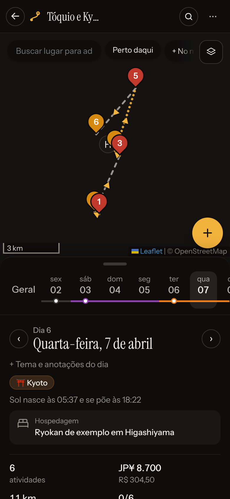

# 🧳 Trip Planner

**Um planner de viagem pessoal: mapa, roteiro dia a dia, hospedagens, orçamento e checklist, num app web que você hospeda de graça.**

*[English version below](#english)*



> **Projeto pessoal, "vibecoded".** Fiz este app para planejar a minha própria viagem, conversando com o
> [Claude](https://claude.ai) (Claude Code): eu descrevia o que queria, ele escrevia o código, eu testava no celular e
> pedia ajustes. Não é um produto, não tem suporte e pode ter arestas. O código está aqui para quem quiser usar,
> copiar ou adaptar, e este README é um guia para você subir o seu.
>
> Os dados da minha viagem **não** estão no repositório: eles ficam no banco de dados de cada instalação. O exemplo
> que vem no app é um roteiro fictício.

## O que tem

- **Várias viagens** numa instalação, com contagem regressiva, duplicar, exportar/importar backup (JSON).
- **Mapa** (Leaflet + OpenStreetMap) com cidades, hospedagens, rota da viagem e ideias sem dia.
- **Dia a dia** em blocos (manhã, café, almoço, tarde, jantar…), com horários, custo e caminho entre as paradas.
  O caminho a pé segue as ruas, e trechos de **trem/metrô** aparecem com a cor da linha e as estações.
- **Voos e trens com fuso**: cada ponta no seu fuso, duração certa, cartão de embarque no dia.
- **Opções no mesmo horário** (ex.: dois restaurantes para o almoço) num carrossel.
- **Hospedagens**, **orçamento** (moeda da viagem + conversão para a sua, câmbio automático), **estatísticas**,
  **calendário**, **checklist** e **compras** (com a cota de isenção da Receita).
- **Modo hoje**: durante a viagem abre no dia atual e mostra a próxima atividade e "Como chegar".
- **Exportar**: PDF, arquivo `.ics` e agenda assinada (Google Agenda / Apple Calendário).
- **Link de compartilhamento** só leitura, sem notas, reservas nem gastos.
- **Celular**: funciona como app (PWA, "Adicionar à tela inicial"), com mapa offline opcional.
- **Senha única** opcional (`APP_PASSWORD`) para proteger a instalação publicada.

| Tela inicial | Visão geral | Celular |
|---|---|---|
|  |  |  |

**Stack:** React 18 + Vite, Leaflet/MapLibre no front; Express na API; SQLite via `@libsql/client`
(arquivo local no computador, [Turso](https://turso.tech) na nuvem); deploy na [Vercel](https://vercel.com).
A interface está em português.

---

## Faça o seu

Você vai precisar de **Node 22.13+** e **git**. Para publicar, de uma conta no GitHub, na Vercel e no Turso
(todas têm plano gratuito, sem cartão).

### 1. Rodar no seu computador

```bash
git clone https://github.com/ArticN/trip-planner.git
cd trip-planner
npm ci
npm run dev        # API em :3000 + front com hot reload em http://localhost:5173
```

Abra http://localhost:5173 e clique em **+ Criar minha primeira viagem**. Para ver o app cheio antes, use o link
**ou carregue um roteiro de exemplo**, logo abaixo (aparece enquanto não há nenhuma viagem). Os dados ficam em `data/planner.db` (fora do git).

Para rodar o app compilado: `npm run build && npm start` (http://localhost:3000).

### 2. Publicar na web (Vercel + Turso, grátis)

1. **Faça um fork** deste repositório (botão *Fork* no GitHub), ou crie um repositório seu e envie o código.
2. **Crie o banco no Turso**: em https://turso.tech crie uma conta e um banco. Copie a **URL**
   (`libsql://<nome>-<usuario>.turso.io`) e gere um **token** (*Create token*). Pelo terminal, com a
   [CLI do Turso](https://docs.turso.tech/cli/introduction):
   ```bash
   turso db create trip-planner
   turso db show trip-planner --url
   turso db tokens create trip-planner
   ```
3. **Importe na Vercel**: em https://vercel.com, *Add New → Project* e escolha o seu repositório. Não precisa
   mudar nada no build: o `vercel.json` já define `npm run build`, a saída `dist` e a API em `api/index.js`.
4. **Variáveis de ambiente** (*Settings → Environment Variables*):

   | Variável | Obrigatória | O que é |
   |---|---|---|
   | `TURSO_DATABASE_URL` | sim | URL do banco (`libsql://…turso.io`) |
   | `TURSO_AUTH_TOKEN` | sim | token do banco |
   | `APP_PASSWORD` | recomendada | senha para entrar no app. Sem ela, **qualquer pessoa com o link pode ver e editar** |

5. **Deploy** (ou *Redeploy* se você criou as variáveis depois do primeiro deploy). As tabelas são criadas
   sozinhas no primeiro acesso.
6. No celular, abra o link e use **Adicionar à tela inicial**.

Se a API responder `a API não iniciou: TURSO_DATABASE_URL não configurada…`, falta alguma variável: confira e faça
um *Redeploy*.

**Levar dados do computador para a nuvem:** no app local, menu ⋯ da viagem → *Exportar backup (JSON)*; no app
publicado, tela inicial → *Importar backup*.

### 3. Personalizar

- **Seu próprio exemplo:** copie `server/examples/demo.js`, troque os dados e registre o arquivo em `EXAMPLES`
  no `server/app.js`. Lembre que o que estiver nesse arquivo fica público no seu repositório: use dados fictícios.
- **Visual:** cores e tema ficam no painel *Aparência* do app; o CSS está em `web/src/styles.css`.
- **Com o Claude:** foi assim que o app nasceu. Abra o repositório no [Claude Code](https://claude.com/claude-code)
  e peça o que quiser mudar. As skills de design usadas estão em `.claude/skills/`.

### Variáveis de ambiente (todas)

| Variável | Onde | Padrão |
|---|---|---|
| `TURSO_DATABASE_URL`, `TURSO_AUTH_TOKEN` | nuvem | sem elas, usa o arquivo SQLite local |
| `APP_PASSWORD` | qualquer | sem senha |
| `DB_PATH` | local | `data/planner.db` |
| `PORT` | local | `3000` |

Há um modelo em [`.env.example`](.env.example). No computador, passe as variáveis no terminal
(ex.: `APP_PASSWORD=minhasenha npm start`). Nunca envie senhas ou tokens para o git.

### Privacidade

- Seus roteiros, reservas, anexos e notas ficam **só no seu banco** (arquivo local ou Turso), nunca no código.
- Backups exportados (`.json`) contêm tudo isso: não os coloque no repositório.
- O link de compartilhamento mostra o roteiro sem notas, links, reservas, gastos e checklist.
- Mapas, busca de lugares, rotas a pé, clima e câmbio usam serviços públicos (OpenStreetMap/Carto, OSRM,
  Open-Meteo, Wikipédia…) direto do navegador.

---

## Para quem for mexer no código

```
api/index.js        função da Vercel que carrega a API
server/app.js       API Express (rotas /api/*), migrações do banco e senha
server/db.js        conexão: SQLite local ou Turso
server/index.js     servidor local (API + build do front)
server/examples/    viagens de exemplo carregáveis na tela inicial
web/src/            front-end React (Home, TripView, DayPanel, MapView, Modals…)
scripts/            dev.mjs (API + Vite juntos) e utilitários
```

Detalhes do formato do backup, do campo `route` (trem/metrô) e da API em
[docs/referencia.md](docs/referencia.md).

---

<a id="english"></a>

## English

**A personal trip planner: map, day-by-day itinerary, stays, budget and checklist, in a web app you can host for
free.** The UI is in Portuguese.

> **Personal, "vibecoded" project.** I built it to plan my own trip by talking to [Claude](https://claude.ai)
> (Claude Code): I described what I wanted, Claude wrote the code, I tested it on my phone and asked for changes.
> It is not a product and has no support. My trip data is **not** in this repo; the bundled example is fictional.

**Run locally** (Node 22.13+):

```bash
git clone https://github.com/ArticN/trip-planner.git && cd trip-planner
npm ci && npm run dev    # http://localhost:5173
```

**Deploy your own (free):**

1. Fork this repo.
2. Create a database on [Turso](https://turso.tech) and copy its URL (`libsql://…`) and an auth token.
3. Import the fork on [Vercel](https://vercel.com) (*Add New → Project*). `vercel.json` already sets the build.
4. Add the environment variables `TURSO_DATABASE_URL`, `TURSO_AUTH_TOKEN` and `APP_PASSWORD` (the login password;
   without it, anyone with the link can see and edit your trips).
5. Deploy (or redeploy after adding the variables). Tables are created on first request.

Your trips live only in your own database. To move local data to the cloud, export a JSON backup from the local
app (⋯ menu) and import it on the deployed one.
