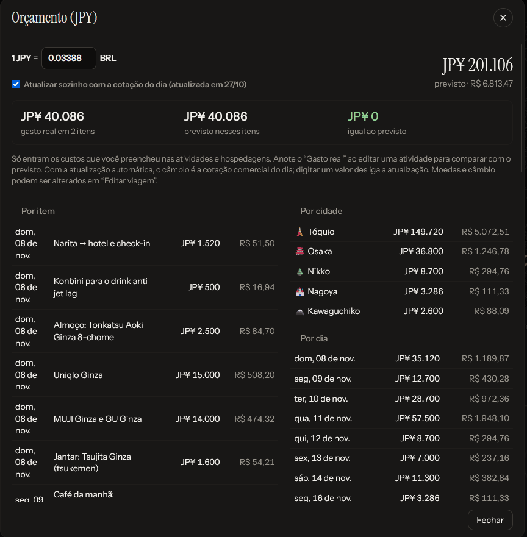

# Dinheiro

[← Índice](README.md)

Todos os valores são digitados na **moeda da viagem** (definida em Editar viagem) e convertidos para a **sua moeda**
quando as duas são diferentes.

## Orçamento

**Orçamento** no topo (ou no ⋯, no celular). Soma o **custo previsto** das atividades e o **preço total** das
hospedagens, e mostra:

- o total previsto, na moeda da viagem e convertido;
- a lista por item (com o link do recibo, quando houver), por cidade e por dia.

Só entram os custos que você preencheu. Das [opções no mesmo horário](roteiro.md#opções-no-mesmo-horário), só a
principal conta.

### Gasto real e recibo

No editor da atividade, **Gasto real** é quanto saiu de fato. Com ele preenchido:

- aparece o campo **Recibo**, com **Foto do recibo** (no celular abre a câmera), que guarda a foto ou o PDF;
- o Orçamento ganha um quadro com o gasto real, o previsto desses mesmos itens e a diferença (acima ou abaixo do previsto);
- o cabeçalho do dia passa a mostrar "gasto de … previstos".

## Análise da viagem

**Análise** no topo da viagem (ou no ⋯, no celular) abre uma página inteira com tudo o que foi planejado de gasto,
pensada para quem quer ver a viagem toda de uma vez, como a família. Quem abre o
[link de compartilhamento](compartilhar-e-backup.md) vê a mesma página pelo botão **Análise de gastos**.

- **Resumo**: o total planejado na sua moeda (e na da viagem), a média por dia, por noite de hotel e de comida por
  dia, quanto das compras conta na cota da Receita, e um aviso com o que ainda está sem preço.
- **Para onde vai o dinheiro**: hospedagem, voos, transporte, comida, passeios e compras, em barra e em tabela.
- **Por dia** e **por cidade**: colunas por dia (passe o mouse ou toque para ver o detalhe; "Ver em tabela" abre os
  números) e um cartão por cidade com noites, dias e a média por dia.
- **Hospedagem**: cada hotel com datas, noites, preço por noite e total.
- **Comida**: média por café, almoço e jantar, as refeições mais caras e a lista completa, com a faixa de preço quando
  há mais de uma opção e a marca de reserva.
- **Passeios**, **Transporte** (por tipo e as viagens entre cidades), **Compras** (por grupo e na cota) e
  **Reservas** (os itens de reserva e ingresso da checklist, feitos ou não).
- **Imprimir ou salvar PDF** gera uma versão para papel.

Como a conta é feita:

- só a opção principal de cada horário entra no total; as outras dão a faixa de preço;
- o preço da hospedagem é dividido pelas noites;
- a passagem dentro do "como chegar" de uma atividade entra em Transporte;
- as compras vêm da lista de compras (os itens de loja do roteiro só contam se a lista estiver vazia);
- hotel ou voo sem preço aparece como "sem preço" e fica fora do total até ser preenchido.

## Câmbio automático

Com moedas diferentes, o Orçamento mostra "1 JPY = … BRL" e a caixa **Atualizar sozinho com a cotação do dia**.

- Ligada (padrão), ao abrir a viagem com internet o app busca a cotação do dia uma vez por dia, no Frankfurter (dados do
  Banco Central Europeu, cerca de 30 moedas) ou, se a moeda não estiver lá, na ExchangeRate-API. Nenhuma pede chave.
- **Digitar um valor** (no Orçamento ou em Editar viagem) desliga a atualização. Marque a caixa de novo para voltar.
- O valor é arredondado para 4 algarismos significativos e a data da última atualização aparece ao lado.

As moedas disponíveis são BRL, USD, EUR, GBP, JPY, ARS, CLP, CAD, AUD, CHF, MXN, KRW, CNY e THB.

## Estatísticas

Menu **⋯ › Estatísticas** (ou no pé da visão geral):

- gasto previsto total, média por dia, distância em linha reta entre as atividades (sem contar voos) e quantas
  atividades estão feitas;
- gráficos de gasto por dia e distância por dia;
- tabela por cidade (noites, atividades e gasto) e por tipo, com as hospedagens numa linha própria.

## Compras e a cota da Receita

**Compras** no topo (ou no ⋯). Para anotar o que você pretende trazer e saber quanto da cota de isenção já está
comprometido.

**Anotar um item:** nome, loja, preço na moeda da viagem (aceita `12.800`, `12800` ou `1.234,50`), grupo (Café e
cozinha, Figures e anime, Roupas e tênis, Eletrônicos, Lembranças, Outros) e dia. Duas caixas:

- **Já comprei**: passa de previsto para comprado. Também dá para marcar direto na lista.
- **Fora da cota**: itens de uso pessoal (como uma roupa que você vai usar) não entram na conta.

Clique num item para editar; o **×** remove (com Desfazer).

**A barra da cota** mostra quanto já foi comprado em dólar e, num tom mais claro, quanto o previsto ainda vai ocupar,
com a marca da cota. Se o total passar da cota, o app avisa quanto passa e estima o imposto: 50% sobre o excedente,
convertido para a sua moeda.

**Ajustes no pé da tela:**

- **Cotação em dólar** (só quando nenhuma das moedas da viagem é o dólar): atualiza sozinha uma vez por dia ao abrir
  Compras, ou pode ser digitada, o que desliga a atualização.
- **Cota de isenção (US$)**: 1.000 por padrão, editável.

> Regra usada (Receita Federal): até US$ 1.000 por pessoa em compras trazidas na bagagem de viagem aérea ou marítima;
> o excedente paga 50% e precisa ser declarado (e-DBV). O free shop da chegada tem cota própria e não entra nessa conta.
> Confira as regras atuais antes de viajar.

**Viagem nacional:** a cota só vale para viagens [internacionais](viagens.md#nacional-ou-internacional). Numa viagem
nacional, Compras mostra só o total comprado e o total com o previsto, na sua moeda, sem barra da cota, cotação em
dólar, imposto, caixa "Fora da cota" nem a nota da Receita. Itens marcados "fora da cota" antes continuam na lista e
entram no total.
