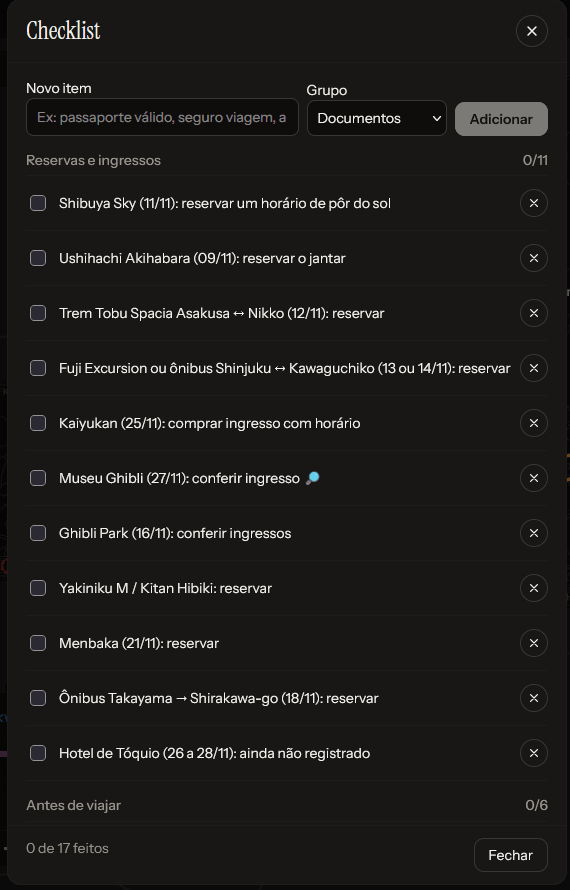

# Organização e agenda

[← Índice](README.md)

## Checklist

**Checklist** no topo (ou no ⋯). Escreva o item, escolha o grupo (**Documentos**, **Reservas**, **Mala**, **Outros**, ou
os grupos que vierem de um backup) e clique em **Adicionar**. Cada grupo mostra quantos itens estão feitos, e o rodapé o
total. O progresso aparece no botão do pé da visão geral e no cartão da viagem em destaque, na tela inicial.

## Notas, links e anexos

No editor de cada atividade (e de cada ideia):

- **Notas e reservas**: texto livre para código de reserva, horário de check-in, o que levar. Aparece no roteiro e no
  painel do pin, mas não no link compartilhado.
- **Links e comprovantes**: endereço e um nome opcional ("ingresso"). Sem `https://`, o app acrescenta. Viram botões no
  roteiro e no painel do pin.
- **Anexos**: ingressos, passagens, vouchers e confirmações. **Anexar arquivo** aceita PDF, fotos e outros arquivos de
  até 4 MB cada; fotos maiores são reduzidas sozinhas mantendo resolução para QR code e código de barras. Os anexos
  aparecem no roteiro e no painel do pin e abrem com um toque.

Sobre os anexos:

- Ficam guardados no próprio banco do app. O limite de 4 MB vem do teto de 4,5 MB por requisição da Vercel.
- Ao abrir a viagem com internet, o app baixa todos os anexos para o aparelho: dá para mostrar o ingresso sem sinal
  (na versão publicada; ver [sem internet](app.md#sem-internet)).
- Quando uma ideia vira atividade (ou o contrário), os anexos vão junto. Excluir a atividade apaga os anexos.
- **Não vão no backup JSON** nem no link compartilhado. Guarde os originais em outro lugar também.

## Calendário

Menu **⋯ › Calendário** (ou no pé da visão geral). Três visões:

- **Mês**: a grade com a cor da cidade, até três atividades por dia e o custo do dia.
- **Semana**: grade por horário, com atividades sobrepostas lado a lado e uma linha para as sem horário.
- **Agenda**: lista dia a dia (é a visão que abre no celular).

Clicar num dia ou atividade abre no roteiro.

## Exportar para a agenda (.ics)

Menu **⋯ › Exportar para agenda (.ics)** baixa um arquivo para importar no Google Agenda, Apple Calendário ou Outlook.
É uma cópia do momento: mudanças posteriores no roteiro não chegam lá (para isso, use os [lembretes](#lembretes)).

- Cada atividade vira um evento com local, detalhes, notas e links na descrição.
- Com fuso (da viagem ou do trecho), o horário vai em UTC e aparece certo em qualquer fuso; sem fuso, fica "flutuante"
  (o mesmo horário em qualquer lugar). Atividade sem horário vira evento de dia inteiro.
- Inclui os alertas configurados em Lembretes, menos nas atividades já feitas.
- Das opções no mesmo horário, só a principal vai.

## Lembretes

Menu **⋯ › Lembretes**. Escolha a antecedência **antes de cada atividade** (de 10 min a 1h30, ou sem lembrete; padrão
30 min) e **antes de voos** (de 1 hora a 1 dia; padrão 3 horas). Só atividades com horário e ainda não feitas avisam.

Duas formas de receber:

1. **Na agenda do celular** (funciona com o app fechado): **Criar agenda com lembretes** gera um link secreto de agenda
   assinada. Use **Adicionar no iPhone / Mac** ou **Adicionar no Google Agenda**. A agenda se atualiza sozinha a cada
   poucas horas, então mudanças no roteiro chegam lá. Dicas da própria tela:
   - iPhone: em Ajustes › Calendário › Contas › (esta agenda), deixe "Remover Alertas" desligado.
   - Google Agenda ignora os alertas do arquivo: escolha as notificações padrão nas configurações da agenda.
   - O link dá acesso ao roteiro com notas e funciona sem senha: não compartilhe. **Desativar** invalida o link.
2. **Neste aparelho, com o app aberto**: marque a caixa e permita as notificações do navegador. Avisa as atividades das
   próximas 24 horas enquanto o app estiver aberto (inclusive em segundo plano no Android).

## Imprimir ou salvar PDF

Menu **⋯ › Imprimir ou salvar PDF** abre a impressão do navegador com uma versão limpa do roteiro: hospedagens,
checklist e cada dia com horário, título, endereço, custo, notas e links. Para PDF, escolha "Salvar como PDF" como
impressora.
