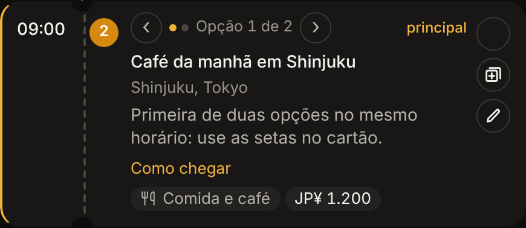

# Roteiro do dia

[← Índice](README.md)

Escolha um dia na barra de dias (ou use as setas ‹ › do cabeçalho, ou ← → no teclado). "Geral" volta para a visão geral.

## Atividades

**Criar:** **＋ Atividade** no pé do dia, o **+** de um bloco (já abre naquele bloco), o botão **+** flutuante no celular,
ou direto [pelo mapa](mapa.md#adicionar-pelo-mapa).

Campos do editor:

| Campo | Para quê |
| --- | --- |
| Título | Obrigatório. |
| Dia, Bloco do dia | Onde a atividade fica. Ver [blocos do dia](#blocos-do-dia). |
| Tipo | Pontos turísticos, Comida e café, Deslocamento, Hospedagem, Compras, Tempo livre ou Voo. Define a cor, o ícone e os filtros. |
| Início, Fim | Opcionais. Com os dois, o app mostra a duração; fim menor que o início vira o dia seguinte. |
| Cidade | Agrupa e colore o dia. |
| Transporte | Como você chega (a pé, metrô, táxi…). Influencia o cálculo do [deslocamento](#tempo-livre-e-deslocamento). |
| Custo previsto, Gasto real | Ver [orçamento](dinheiro.md#orçamento). Com gasto real aparece o campo do recibo. |
| Endereço | Vale sozinho como texto; não precisa de posição no mapa. |
| Detalhes, Notas e reservas | Texto livre. As notas são privadas (não vão no link compartilhado). |
| Trem ou metrô até aqui | Linhas, estações e baldeações. Ver [caminho no mapa](mapa.md#caminho-a-pé-e-linhas-de-trem-e-metrô). |
| Trecho (voo, trem, ônibus) | Só em Voo e Deslocamento: número, códigos, escalas e fusos. Ver [voos](voos.md). |
| Links e comprovantes, Anexos | Ver [notas, links e anexos](organizacao.md#notas-links-e-anexos). |
| Depois de visitar | 1 a 5 estrelas e um comentário de como foi. Aparece no roteiro e no painel do pin. |
| Posição no mapa | **Buscar** aceita endereço, nome do lugar, link do Google Maps (longo ou curto, `maps.app.goo.gl`) ou coordenadas coladas (`35.6586, 139.7454` ou `35°39'31.0"N 139°44'43.4"E`). Também dá para **Marcar no mapa** ou digitar latitude e longitude. |

Ao **Salvar** uma atividade sem posição, o app procura sozinho: primeiro o que estiver em Endereço (coordenadas, link
do Google Maps ou o endereço em si), depois o nome do lugar perto da cidade da atividade, e por último o bairro do
endereço (aí avisa que a posição é aproximada). Endereços copiados do Google com CEP, `1 Chome−17−5` e nome do prédio
em japonês funcionam: o app tira esses pedaços quando o endereço completo não é achado. Limitações: precisa de
internet (sem internet a atividade é salva sem posição), usa o OpenStreetMap (Nominatim e Photon), que às vezes não tem
lojas pequenas, e não procura em Voo, Deslocamento e Tempo livre. Quando não acha, o aviso pede para colar o link ou as
coordenadas do Google Maps.

No roteiro, cada atividade é um "ingresso": horário no canhoto, título, local, detalhes, notas, links, anexos,
**Como chegar** (rota no Google Maps) e etiquetas (tipo, duração, transporte, custo). O círculo à direita marca como
**feita**; o lápis edita.

Atividades sem posição ganham a etiqueta **sem local**, e as que se sobrepõem no horário ficam marcadas como
**sobreposto** (o "Tempo livre" não entra nessa conta). Na visão geral, **Ver em quais dias** filtra só os dias com
esses avisos.

**Excluir** mostra **Desfazer** por alguns segundos antes de apagar de vez (vale também para ideias, itens do checklist,
compras e anexos). **Mover para ideias** tira a atividade do dia e guarda na lista de [ideias](#ideias-sem-data).

## Blocos do dia

O dia é dividido em sete blocos, nesta ordem: **Manhã**, **Café da manhã**, **Depois do café**, **Almoço**,
**Depois do almoço**, **Jantar** e **Depois do jantar**. Os vazios ficam como títulos discretos com "livre".

- O **+** de um bloco cria a atividade ali. Nas refeições, já vem com o tipo Comida e o nome da refeição.
- **Arraste** uma atividade para outra posição ou para o título de outro bloco (no computador).
- **Ordenar por horário** ordena as atividades com horário dentro de cada bloco; as sem horário ficam onde estão.

**Como o bloco é escolhido** quando o campo "Bloco do dia" está em *Automático*:

1. Comida com "café da manhã", "almoço" ou "jantar" no título (ou breakfast, lunch, dinner) vai para essa refeição.
2. Com horário, a atividade vai para "Depois de…" da última refeição com horário antes dela. Sem refeição antes:
   antes das 8h é Manhã, até 12h Depois do café, até 19h Depois do almoço, e depois disso Depois do jantar.
3. Sem horário, fica no mesmo bloco da atividade anterior.

Escolher um bloco no editor (ou arrastar) fixa a atividade nele.

## Tempo livre e deslocamento

Entre duas atividades, o roteiro mostra uma linha com o deslocamento (quando as duas têm posição no mapa) e o tempo que
sobra (quando têm horário). A altura do espaço
acompanha o tempo livre (três horas livres ocupam bem mais que dez minutos). A linha fica âmbar quando não dá tempo de
chegar e escreve "45min livre" quando sobra meia hora ou mais. O link **rota** abre o trajeto no Google Maps.

Como o tempo é calculado:

- **Com trem ou metrô cadastrado** na atividade de destino: a pé até a estação, o tempo no trem (o que você digitou, ou
  estimado pela distância e o tipo de trem) e a pé da estação até o destino. Ex.: "7min a pé · G Ginza, Ginza → Asakusa 18min · 7min a pé".
- **A pé ou de carro** (pelo campo Transporte, ou a pé quando os dois pontos estão a até 2,5 km): rota real pelas ruas
  no servidor público do OpenStreetMap (OSRM). Carro ganha 20% de folga.
- **Transporte público sem estações cadastradas**: estimativa de 10 minutos para embarcar mais o trajeto a 25 km/h.

O "~" na frente indica estimativa (sem rota exata ou sem internet). Rotas já consultadas ficam guardadas no aparelho.

## Opções no mesmo horário

Para quando você está em dúvida entre lugares para o mesmo horário, como três cafés da manhã.

1. No ingresso da atividade, clique no botão de **cartões empilhados** ("Outra opção para este horário"). O editor abre
   com o mesmo dia, bloco e horário.
2. As opções viram um **carrossel** no mesmo ingresso: as setas ‹ › (ou deslizar o dedo para o lado, no celular) trocam
   a opção mostrada e o mapa vai até ela. As outras opções aparecem no mapa como pinos apagados com o mesmo número.
3. A primeira é a **principal**: só ela conta no orçamento, nas estatísticas, na agenda `.ics`, nos lembretes e no PDF.
   **Tornar principal** troca a principal sem descartar as outras.
4. Para tirar uma opção do carrossel, abra o editor dela e use **Separar das outras opções**, ou exclua a opção.

Arrastar uma opção para outro bloco leva o grupo inteiro. O link compartilhado mostra a principal e cita as outras
embaixo ("ou …"). Voos e deslocamentos não têm opções.

> Por baixo: as opções são atividades normais do mesmo dia com o mesmo texto no campo `alt`. A principal é a que vem
> primeiro na ordem do dia. Ver [formato do backup](compartilhar-e-backup.md#formato-do-json).

## Ideias sem data

Lugares que você quer conhecer mas ainda não sabe quando. Ficam na visão geral, em **Ideias**.

- **+ Ideia** (ou o **+** flutuante na visão geral, no celular, ou **+ No mapa** / busca do mapa estando na visão geral).
- Aparecem no mapa da visão geral.
- **Agendar…** escolhe um dia: a ideia vira atividade no fim daquele dia, com os anexos junto.
- O caminho inverso é **Mover para ideias**, no editor da atividade.

## Tema do dia, tempo e sol

No cabeçalho de cada dia:

- **+ Tema e anotações do dia**: um título ("Templos de Higashiyama") e anotações livres (plano B se chover…). Entram na busca.
  Um endereço colado nas anotações (por exemplo um roteiro a pé do Google Maps) aparece como link curto,
  "rota no Google Maps" ou o nome do site, em vez da URL inteira. O mesmo vale para detalhes, notas e avaliação
  das atividades. Texto comprido sempre quebra linha dentro da caixa.
- **Tempo**: máxima, mínima e chance de chuva (Open-Meteo, sem chave). Até 16 dias antes aparece a previsão; mais longe
  que isso, "Costuma fazer", a média da mesma época nos últimos 3 anos; dias que já passaram mostram "Fez".
- **Sol nasce às… e se põe às…**, calculado no próprio app pelo primeiro ponto do dia (ou pela hospedagem). Só aparece
  se a viagem tiver fuso.
- Resumo: número de atividades, custo previsto (ou gasto real), distância em linha reta e quantas estão feitas.

## Filtros

Os ícones de tipo e o seletor **Todas / A fazer / Feitas** filtram o roteiro do dia e o mapa. Na visão geral, os
mesmos filtros ficam em "Camadas do mapa".

## Busca

A lupa no topo, ou as teclas **/** ou **Ctrl/⌘ + K**. Procura em atividades (título, endereço, detalhes, notas,
comentário, número e códigos do voo), ideias, hospedagens (inclusive nº da reserva), cidades e temas do dia, sem ligar
para acentos. Use ↑ ↓ e Enter para escolher; o resultado abre no lugar certo.

## Modo hoje

Durante a viagem (pelo fuso do destino):

- Abrir a viagem leva direto ao dia de hoje, e a tela inicial oferece **Abrir o dia de hoje**.
- O dia de hoje fica destacado na barra de dias e na lista; os que já passaram ficam mais apagados.
- O roteiro de hoje mostra o painel **Agora**, como a placa de uma estação: a atividade em andamento (ou a próxima não
  feita) em destaque, com a anterior e a seguinte ao lado. O ingresso correspondente ganha a etiqueta "Agora" ou "Próxima".
  Desde a v1.52 o painel fica logo abaixo do título do dia (no celular aparece sem rolar), diz quanto falta ("termina
  em 40min", "começa em 1h10") e tem **Como chegar** para a atividade em destaque.
- O relógio anda sozinho: o "Agora" troca de atividade na hora certa com o app aberto, e se o dia vira (ou o app volta
  do fundo no dia seguinte) quem estava no dia de hoje passa para o novo dia. Quem estava olhando outro dia fica onde está.
- **Como chegar** em cada atividade abre a rota no Google Maps.
