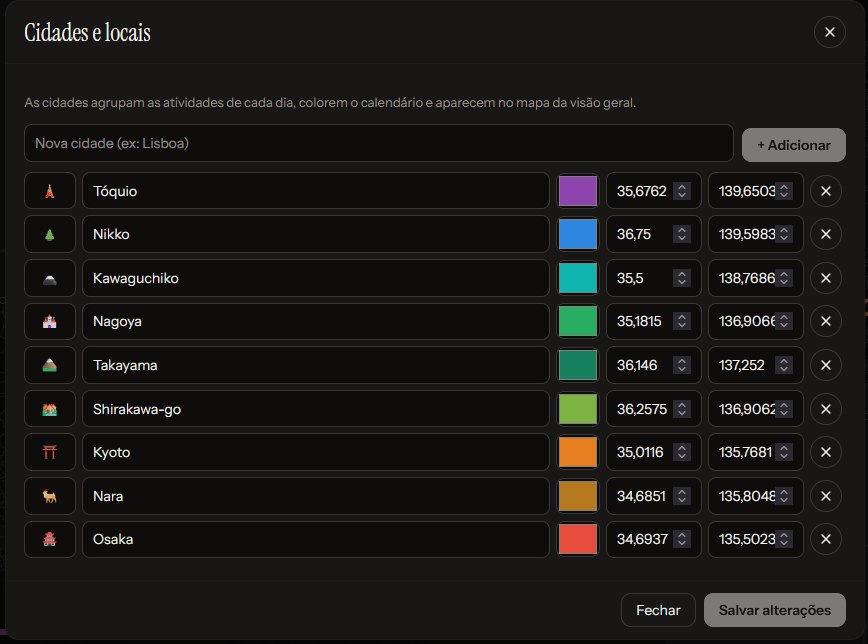
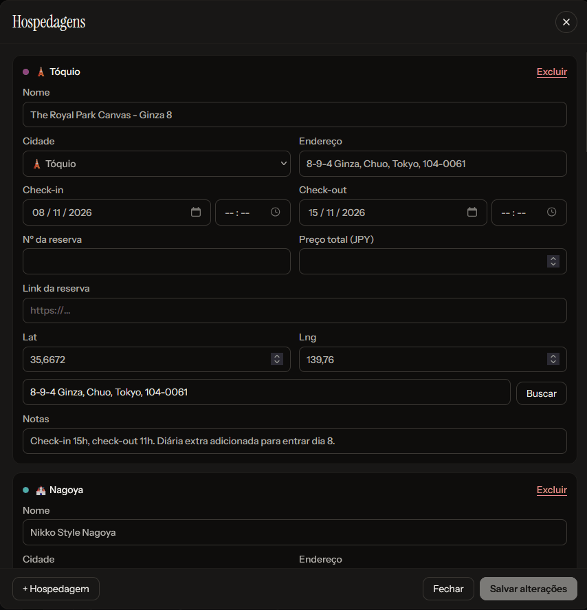

# Viagens, cidades e hospedagens

[← Índice](README.md)

## Viagens

Uma instalação guarda quantas viagens você quiser. Cada uma tem as próprias datas, moeda, cidades, hospedagens e roteiro.

**Criar:** na tela inicial, **+ Nova viagem**. Um assistente em 4 passos monta a viagem e já deixa quase tudo
configurado a partir do destino (desde a v1.45):

1. **Destino**: um ou mais países (busca por nome sem acento, código ou cidade: "japao", "EUA", "Paris"). Atalhos para
   os países mais procurados e para o seu, que vira viagem nacional. Aqui fica também **Onde moro**, salvo para as
   próximas viagens e para o [Meu mapa](mapa.md#meu-mapa).
2. **Datas**: ida e volta, com atalhos (fim de semana, 1 semana, 10 e 15 dias, 3 semanas).
3. **Já criar**: as cidades mais visitadas do país (as duas primeiras vêm marcadas; dá para buscar outra), os
   **voos de ida e volta** (aeroporto de casa → principal aeroporto do destino; numa viagem nacional, o aeroporto mais
   perto da primeira e da última cidade), as **notas sobre o destino** e uma **checklist básica**.
4. **Revisar**: nome e bandeira sugeridos ("Japão 2026"), moedas, câmbio do dia, fuso e a lista do que vai ser criado.

O que vem pronto, pelo país:

- **Moeda** do destino e a **sua moeda** (do país onde mora); **câmbio** com a cotação do dia, que continua se
  atualizando sozinho (veja [câmbio automático](dinheiro.md#câmbio-automático)). Sem internet a viagem é criada mesmo
  assim e busca a cotação quando a conexão voltar.
- **Fuso horário** do destino e a diferença para o seu ("9 h à frente").
- **Tipo**: nacional quando todos os países escolhidos são o seu; internacional nos outros casos.
- **Notas** no grupo "Sobre <país>": moeda, fuso, idioma, tomadas e voltagem (avisa quando precisa de adaptador),
  números de emergência e trânsito pela esquerda, quando for o caso.
- **Checklist**: passaporte, visto, seguro, cartão, dinheiro local, adaptador e chip (internacional) ou documento,
  reservas e carregadores (nacional).
- **Mapa**: o contorno dos países do destino. Enquanto a viagem não tem pontos com posição, o mapa abre enquadrando o país.

O app tem dados prontos de cerca de 60 países (os mais procurados das Américas, Europa, Ásia, África e Oceania, em
`web/src/countries.js`). Os outros também podem ser escolhidos: nome, idioma e fuso vêm do navegador e a moeda fica para
escolher na revisão. Tudo que o assistente cria dá para editar ou apagar depois. Regras de entrada (passaporte, visto,
vacinas) não são preenchidas: confira no consulado.

Depois de criada, em **Editar viagem** ficam os campos de sempre:

- **Nome** e **subtítulo** (opcional), e um emoji da lista.
- **Início** e **Fim**: definem os dias do roteiro (um por data, inclusive as duas pontas).
- **Países de destino**: trocar o país ajusta moeda e fuso para o novo destino.
- **Tipo de viagem**: **Automático** (padrão), **Nacional** ou **Internacional**. Veja [Nacional ou internacional](#nacional-ou-internacional).
- **Moeda da viagem** e **Sua moeda**: os custos são digitados na moeda da viagem e convertidos para a sua. Com moedas
  diferentes aparece o campo **Câmbio** (quanto 1 unidade da moeda da viagem vale na sua). Veja [câmbio automático](dinheiro.md#câmbio-automático).
  Numa viagem nacional fica um campo só, **Moeda**, sem câmbio.
- **Foto de capa** (opcional): escolha do aparelho ou cole um link. A foto escolhida é reduzida no próprio aparelho
  (cerca de 100 KB) antes de ser salva. Aparece no cartão da tela inicial.
- **Fuso horário do destino** (ex.: `Asia/Tokyo`): importante. Com ele o app sabe que dia e hora são "agora" no destino
  (modo hoje), calcula o nascer e o pôr do sol e grava a agenda `.ics` no horário certo.

**Editar, duplicar, excluir:** menu **⋯ › Editar viagem** (ou o link "Editar" ao lado das datas, na visão geral).

- **Duplicar** cria "(cópia)" com tudo, mas zera o que é de quem já viajou: atividades feitas, gasto real, avaliações,
  itens do checklist marcados e compras marcadas como compradas. Bom para reaproveitar um roteiro.
- **Excluir** apaga a viagem e tudo dela, sem desfazer. Exporte um [backup](compartilhar-e-backup.md#backup) antes, se quiser guardar.

## Nacional ou internacional

Cada viagem é **nacional** (dentro do país onde você mora, como uma ida ao Amazonas para quem mora no Brasil) ou
**internacional**. O tipo aparece na visão geral, embaixo das datas, junto com os estados (nacional) ou os países
(internacional) por onde a viagem passa: "Viagem nacional · Amazonas", "Viagem internacional · Japão".

**Automático (padrão):** a viagem é nacional quando todas as cidades com posição e todos os países de destino ficam
no país escolhido em **Onde moro** (no assistente de nova viagem ou no [Meu mapa](mapa.md#meu-mapa) da tela inicial). Sem "Onde moro" ou sem cidades com posição, ela conta
como internacional, que era como o app tratava todas as viagens antes. O tipo acompanha as cidades: adicionar uma cidade
fora do país transforma a viagem em internacional.

**Escolher à mão:** em **Editar viagem › Tipo de viagem**, escolha Nacional ou Internacional para fixar o tipo
(por exemplo, numa viagem que ainda não tem cidades). Volte para Automático para o app decidir de novo.

O que muda numa viagem nacional:

- **Moeda**: uma só, a sua, sem câmbio nem conversão. Ao salvar, a moeda da viagem passa a ser a sua moeda.
- **Compras**: viram uma lista com o total comprado e o previsto, sem cota da Receita, dólar, imposto nem free shop
  (veja [Compras](dinheiro.md#compras-e-a-cota-da-receita)).
- **Checklist**: a sugestão do campo troca passaporte e seguro viagem por documento com foto.

Voos, escalas, o mapa do dia e o resto do roteiro funcionam igual nos dois tipos.

## Tela inicial

- **Viagem em destaque**: a que está acontecendo ou a próxima. Antes da viagem mostra uma contagem regressiva
  **DD:HH:MM:SS** que anda a cada segundo, o progresso do checklist e quantas atividades tem o primeiro dia.
  Desde a v1.53 a contagem vai até a **hora real de saída**: o voo do primeiro dia (no fuso de onde ele sai) ou,
  sem voo, a primeira atividade com hora nesse dia; sem nenhuma hora, meia-noite do primeiro dia no fuso da viagem.
  Entre a decolagem e o pouso aparece **Em voo** com o tempo para pousar. Durante a viagem mostra "Dia N de M", a próxima atividade de hoje
  e o botão **Abrir o dia de hoje**.
- **Próximas viagens** e **Concluídas**, com contagem regressiva (dias inteiros até a saída) ou "Dia N da viagem" em
  cada cartão. No cabeçalho do roteiro (computador) a mesma contagem aparece como "Faltam DD:HH:MM:SS".
- **Importar backup**, [Meu mapa](mapa.md#meu-mapa), [Novidades](app.md#novidades) e [Aparência](app.md#aparência).
- Sem nenhuma viagem, a tela oferece **ou carregue um roteiro de exemplo**, que cria a viagem fictícia para você explorar.

## Cidades e locais

Menu **⋯ › Cidades e locais** (ou "Cidades" no pé da visão geral).

As cidades agrupam as atividades, dão cor aos dias (na barra de dias, no calendário e no diagrama de metrô) e aparecem
no mapa da visão geral.

- **+ Adicionar**: digite o nome; o app procura a posição no OpenStreetMap e já preenche latitude e longitude. Se não
  achar, preencha à mão.
- Cada cidade tem **emoji**, **nome**, **cor** e posição, todos editáveis. Clique em **Salvar alterações** no fim.
- **Excluir** uma cidade não apaga nada: as atividades, ideias e hospedagens dela ficam sem cidade.
- A cidade especial **Em trânsito** é criada sozinha em toda viagem, para voos e deslocamentos. Ela não aparece nesta
  tela nem no Meu mapa.

> Por baixo, cada cidade tem uma chave curta tirada do nome (ex.: `kyoto`), que é o que liga atividades e hospedagens a
> ela. Renomear a cidade não muda a chave, então nada se perde.

## Hospedagens

**Hospedagens** no topo (ou no ⋯, no celular).

Campos: nome, cidade, endereço, **check-in** e **check-out** (data e horário), nº da reserva, preço total, link da
reserva, posição (busca pelo endereço ou lat/lng) e notas. **+ Hospedagem** já sugere o check-in no dia do último
check-out. Clique em **Salvar alterações** para gravar.

O que elas fazem pelo resto do app:

- **Rota da viagem**: na visão geral, as hospedagens em ordem formam a rota entre cidades (linha cheia no mapa) e o
  [diagrama de linha de metrô](mapa.md#diagrama-de-metrô). Cidades sem hospedagem viram **bate-voltas** (tracejado).
- **Cabeçalho do dia**: cada dia mostra a hospedagem daquela noite, com o estado: porta aberta no dia do check-in
  ("a partir das 15:00"), cama nos outros dias, e um cartão de check-out ("até 11:00") no dia em que você sai.
  O número da reserva e o link aparecem no mesmo cartão.
- **Noites por cidade** nas estatísticas e o **preço** no orçamento.
- **Trajeto a partir do hotel**: na primeira atividade do dia com trem ou metrô, o caminho parte da hospedagem.

Regra das datas: você dorme na hospedagem nas noites de `check-in` até a véspera do `check-out`. Um hotel de 05/04 a
08/04 cobre as noites de 5, 6 e 7 (três noites); no dia 8 aparece só como check-out.
