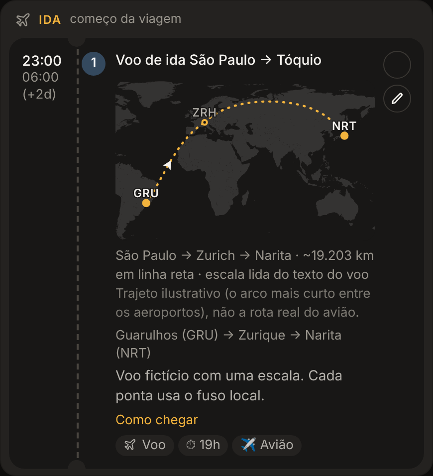

# Voos e trechos

[← Índice](README.md)

## Cadastrar um voo ou trem

Crie uma atividade com o tipo **Voo** (ou **Deslocamento**, para trem e ônibus). O editor ganha a seção
**Trecho (voo, trem, ônibus)**:

| Campo | Exemplo | Observação |
| --- | --- | --- |
| Nº do voo / trem | `LX 93` | Aparece no bilhete e entra na busca. |
| Chega no dia | 05/04 | Para voos que pousam em outro dia. Sem ele, um fim menor que o início vira o dia seguinte. |
| Saída (código), Chegada (código) | `GRU`, `NRT` | Em voo, use o código IATA do aeroporto. Em trem, pode ser texto (`Tóquio`, `Kyoto`). |
| Escalas | `ZRH` ou `ICN, ADD` | Só em voo. Códigos na ordem do voo, separados por vírgula ou espaço. Opcional: veja [reconhecimento de escalas](#escalas-reconhecidas-sozinhas). |
| Fuso da saída, Fuso da chegada | `America/Sao_Paulo`, `Asia/Tokyo` | Vazios, valem o fuso da viagem. |

**Digite os horários no fuso local de cada ponta, como estão no bilhete.** A duração é calculada com os fusos: um voo
que sai às 23:00 de São Paulo e chega às 06:00 de Tóquio dois dias depois mostra a duração real, "(+2d)" no horário de
chegada e "horários locais" no bilhete. Na agenda `.ics`, o voo vai em UTC e cada agenda mostra no fuso de quem vê.

Voos e trens têm cara de bilhete, com os códigos em destaque. Voos não podem ser arrastados nem ter
[opções no mesmo horário](roteiro.md#opções-no-mesmo-horário), e o cálculo de deslocamento ignora os trechos com voo.

## Ida e volta

O primeiro voo da viagem (pela data e hora) vira a **Ida** e o último vira a **Volta** (quando há mais de um). Eles saem
dos blocos do dia e ganham um cartão de viagem próprio: a ida abre o dia em que a viagem começa e a volta fecha o dia
em que ela termina. Num dia só de voo, os blocos vazios nem aparecem. Voos no meio da viagem continuam nos blocos.

## Mapa-múndi do voo

Todo voo ganha um mapa-múndi no próprio cartão: saída, escalas e chegada ligadas por arcos, com um aviãozinho
percorrendo a rota, os nomes das cidades e a distância em linha reta.

É um **trajeto ilustrativo**: o caminho mais curto sobre o globo entre os aeroportos, não a rota que o avião faz de
verdade (essa só existe depois do voo e depende de serviços pagos; está nas "Ideias para o futuro" do app). O mapa e a
lista de aeroportos vêm embutidos no app, então funcionam sem internet.

### No mapa grande do dia

No dia de um voo, o mapa grande deixa de ficar preso na região da viagem e mostra o trajeto inteiro: origem, cada
escala e destino como pontos, ligados por arcos com setas. Ao voltar para um dia comum, o mapa volta para a região.

## Escalas reconhecidas sozinhas

Você não precisa preencher o campo Escalas. O app lê o texto do voo: um endereço como
`Guarulhos (GRU) → Zurique → Narita (NRT)` já desenha GRU → ZRH → NRT, no cartão e no mapa grande. Nesse caso a legenda
do mapa diz "escala lida do texto do voo".

### Como funciona por baixo

Não tem IA nem serviço externo. São regras fixas em [`web/src/flights.js`](../../web/src/flights.js):

1. **Corta o texto nas setas.** O endereço `Guarulhos (GRU) → Zurique → Narita (NRT)` vira três pedaços: o primeiro é
   a origem, o último é o destino e o que fica no meio são as escalas. Valem `→` e `->`. Se o endereço não tiver setas,
   o app tenta o título da atividade.
2. **Procura um código em cada pedaço.** Primeiro um código entre parênteses, como `(GRU)`; senão, qualquer palavra de
   três letras maiúsculas, como `NRT`. O código só vale se existir na lista de **3.266 aeroportos** embutida no app
   (dados públicos do [OurAirports](https://ourairports.com): aeroportos grandes e médios com voos regulares, cada um
   com latitude, longitude e cidade; gerada por `scripts/airports.mjs`).
3. **Sem código, procura o nome da cidade.** O app tira acentos, maiúsculas, o que estiver entre parênteses e um
   "Aeroporto de" no começo, e consulta uma tabela escrita à mão com os nomes (em português e inglês) das cidades que
   mais servem de escala: "zurique" e "zurich" dão ZRH, "seul" dá ICN, "adis abeba" dá ADD. São 82 nomes para 50
   aeroportos (lista abaixo).
4. **Desenha.** Com GRU → ZRH → NRT em mãos, liga cada par de aeroportos pelo arco de grande círculo (o caminho mais
   curto sobre a esfera), que no mapa plano vira uma curva. Um voo que cruza o Pacífico continua do outro lado em vez
   de dar a volta no mapa.

**O que tem prioridade:**

- O campo **Escalas** preenchido vale mais que o texto: se você escreveu `FRA` ali, o mapa usa FRA mesmo que o endereço
  fale em Zurique.
- **Saída** e **Chegada** com códigos válidos valem mais que as pontas do texto. O texto só completa o que falta.
- Com os campos de código vazios, o bilhete não mostra a linha "GRU 23:00 → NRT 06:00", mas o mapa funciona pelo texto.
  Vale preencher os dois para ter o bilhete completo.

**Limitações (e como contornar):**

| Texto | Resultado | Por quê | Como resolver |
| --- | --- | --- | --- |
| `Guarulhos (GRU) → Reykjavik → Narita (NRT)` | GRU → NRT, sem escala | "Reykjavik" não está na tabela de cidades | `Reykjavik (KEF)` ou `KEF` no campo Escalas |
| `Guarulhos (GRU) → Zurique, Suíça → Narita (NRT)` | GRU → NRT | O pedaço precisa ser só o nome da cidade | `Zurique` ou `Zurique (ZRH)` |
| `Voo São Paulo → Zurique → Tóquio` (título, sem códigos nos campos) | ZRH → NRT | "voo são paulo" não é um nome da tabela | Preencher Saída `GRU` |
| `GRU - ZRH - NRT` ou `GRU > ZRH > NRT` | sem mapa | Só `→` e `->` separam os trechos | Usar `→` ou `->` |
| Código digitado que não está na lista | aparece "XXX fora da lista de aeroportos" | Aeroporto pequeno ou sem voo regular | Usar o código do aeroporto principal da cidade |

Um pedaço não reconhecido é simplesmente pulado, sem aviso. Se o mapa ficou sem uma escala, confira o texto ou
preencha o campo Escalas.

Cidades reconhecidas pelo nome

| Aeroporto | Nomes aceitos |
| --- | --- |
| ZRH | zurique, zurich |
| FRA | frankfurt |
| MUC | munique, munich |
| CDG | paris |
| LHR | londres, london |
| AMS | amsterda, amsterdam |
| LIS | lisboa, lisbon |
| MAD | madri, madrid |
| FCO | roma, rome |
| MXP | milao, milan |
| VIE | viena, vienna |
| GVA | genebra, geneva |
| BRU | bruxelas, brussels |
| CPH | copenhague, copenhagen |
| HEL | helsinque, helsinki |
| IST | istambul, istanbul |
| ATH | atenas, athens |
| DXB | dubai |
| DOH | doha |
| AUH | abu dhabi |
| ADD | adis abeba, addis abeba, addis ababa |
| JNB | joanesburgo, johannesburg |
| ICN | seul, seoul |
| PEK | pequim, beijing |
| PVG | xangai, shanghai |
| HKG | hong kong |
| TPE | taipei |
| SIN | singapura, singapore |
| BKK | bangcoc, bangkok |
| NRT | toquio, tokyo, narita |
| HND | haneda |
| KIX | osaka |
| JFK | nova york, nova iorque, new york |
| EWR | newark |
| MIA | miami |
| ATL | atlanta |
| IAH | houston |
| DFW | dallas |
| ORD | chicago |
| LAX | los angeles |
| SFO | sao francisco, san francisco |
| YYZ | toronto |
| MEX | cidade do mexico, mexico city |
| PTY | panama, cidade do panama |
| BOG | bogota |
| LIM | lima |
| SCL | santiago |
| EZE | buenos aires |
| GRU | guarulhos, sao paulo |
| GIG | rio de janeiro, galeao |

Acentos e maiúsculas não importam ("Zürich" e "São Paulo" funcionam). Para acrescentar uma cidade, inclua o nome
em `HUBS`, em `web/src/flights.js`.

